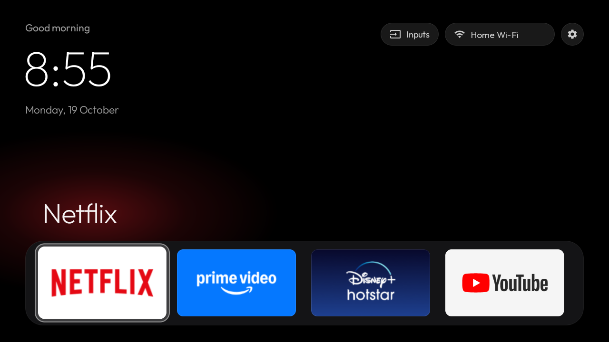
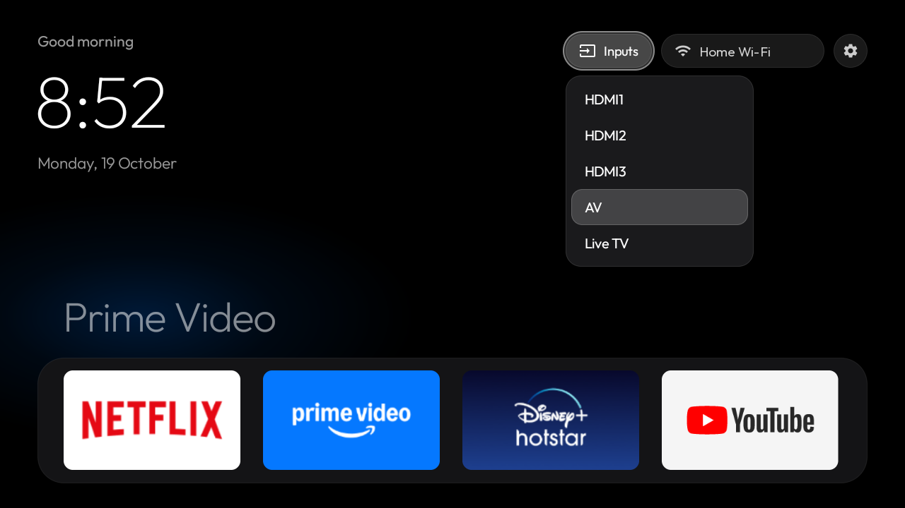
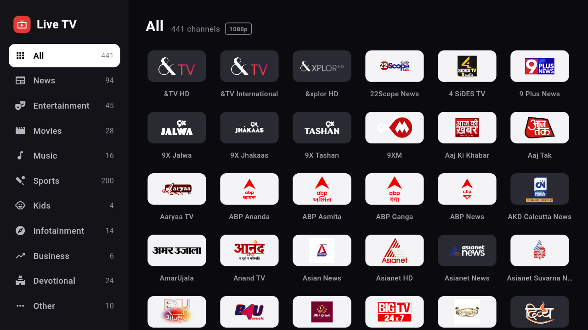
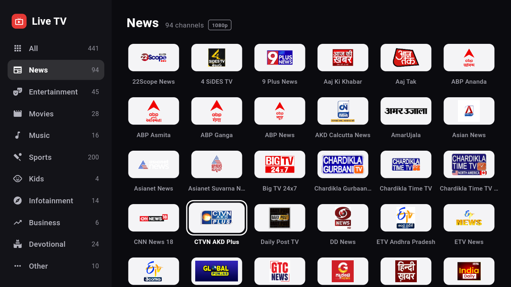

# Android TV Makeover

Debloat an Android TV over Wi-Fi, replace its ad-filled home screen with a clean Apple TV style
launcher, and add a fast live TV app for Indian channels. Everything is reversible.

Built and tested on a Xiaomi MiTV-AXSO0 (Android TV 9, 1 GB RAM). It should work on most Android TV /
Google TV sets (Xiaomi, TCL, Hisense, Sony, OnePlus, Realme, Nvidia Shield). It does not work on
Samsung Tizen, LG webOS or Fire TV.

| Home screen | Inputs menu |
|---|---|
|  |  |

| Live TV app | Categories |
|---|---|
|  |  |

## What's inside

| Path | What it is |
|---|---|
| `launcher/` | Native Android TV launcher (Java, AndroidX RecyclerView, minSdk 28, ~45 MB RAM). Pitch black, dock of four apps with a colour glow sampled from the focused app, 4-column app grid below, one glass focus highlight, clock and greeting in Outfit, frosted Inputs / Wi-Fi / Settings pills, HDMI/AV/Live TV input switcher. Deterministic D-pad navigation. |
| `apps/live-tv/` | Live TV app (Flutter), a modified fork of [kananinirav/Indian-IPTV-App](https://github.com/kananinirav/Indian-IPTV-App). Category sidebar, small channel logos, 1080p streams only, instant start from cache, Up/Down channel switching, automatic backup streams. See [apps/live-tv/README.md](apps/live-tv/README.md). |
| `tools/tv` | Tiny ADB client in Python (`adb-shell`): `shell`, `screenshot`, `push`, `pull`, `key`. Works when macOS Local Network privacy blocks the stock `adb` binary. |
| `profiles/` | Debloat profiles: which packages to disable for a given TV. |
| `PROMPT.md` | The prompt to give a coding assistant (e.g. Claude Code) to do all of this on your TV, step by step, with screenshots. |

## Quick start

On the TV: Settings → Device Preferences → About → press OK on **Build** 7 times, then go back →
Developer options → turn on **USB debugging** (and Network/ADB debugging if your TV shows it).

On a Mac or Linux computer on the same Wi-Fi:

```bash
./setup.sh
```

```bash
tools/find-tv.sh
```

Accept the "Allow USB debugging?" prompt on the TV (tick "Always allow"). Then back up first:

```bash
./backup.sh
```

### 1. Debloat

Profiles list packages to disable with `pm disable-user` (nothing is uninstalled). Package names differ
between brands, so for another TV copy the profile and edit it; check what a package does with
`tools/tv shell "dumpsys package <name>"`. Never disable TV input services, the remote/Bluetooth
services, the keyboard, or Play Store/Services.

```bash
./disable.sh profiles/xiaomi-mitv-axso0.txt
```

### 2. Launcher

Edit `launcher/app/src/main/res/values/config.xml` (dock apps, hidden apps, greeting name, wallpaper),
then:

```bash
./build_and_install.sh
```

Needs JDK 17 and the Android SDK (platform 34, build-tools 34): `brew install openjdk@17` and
`brew install --cask android-commandlinetools`, then
`sdkmanager "platforms;android-34" "build-tools;34.0.0"`. If several apps claim Home, the script sets
the default with `cmd package set-home-activity`.

### 3. Live TV app (optional)

Needs Flutter (`brew install --cask flutter`):

```bash
./build_live_tv.sh
```

### Undo everything

```bash
./restore.sh profiles/xiaomi-mitv-axso0.txt --uninstall
```

Or re-enable a single app: `tools/tv shell "pm enable <package>"`.

## Using the launcher

- Left/Right moves along a row; Up/Down always moves exactly one row.
- Up from the dock goes to the top buttons; Down from the dock scrolls into the app grid.
- Back returns to the dock. Home while already home also returns to the dock.
- Inputs opens HDMI / AV / Live TV; it switches through Android's TV input framework.
- It remembers the last tile you were on.

## Changing the launcher

All in `launcher/app/src/main/res/values/config.xml`:

- **Dock:** `dock_packages`, package names left to right. Find one with
  `tools/tv shell "pm list packages | grep -i <name>"`.
- **Hide an app from the grid:** add it to `hidden_packages`.
- **Greeting name:** `greeting_name` (empty for just "Good evening").
- **Wallpaper:** put an image at `launcher/app/src/main/res/drawable-nodpi/wallpaper.jpg` and set
  `use_wallpaper` to `true`. Pitch black otherwise.

## Troubleshooting

- **`adb` says "No route to host" on macOS although the port is open:** that's macOS Local Network
  privacy blocking the `adb` binary. `tools/tv` doesn't have that problem.
- **Home shows a chooser or the old launcher:**
  `tools/tv shell "cmd package set-home-activity com.kulwant.atvhome/.HomeActivity"`
- **The launcher crashes and Home does nothing:**
  `tools/tv shell "pm enable com.google.android.tvlauncher"`
- **Gradle can't download its distribution (Java connection timeout) but curl works:** download the
  zip named in `gradle/wrapper/gradle-wrapper.properties` with curl and point `distributionUrl` at it
  with `file\:/path/to/zip`.

## Credits and licences

- Everything in this repo is MIT licensed (`LICENSE`), except the parts below, which keep their own
  licences.
- Live TV app: fork of [kananinirav/Indian-IPTV-App](https://github.com/kananinirav/Indian-IPTV-App)
  (MIT, see `apps/live-tv/LICENSE`). It's a player for public playlists from
  [iptv-org](https://github.com/iptv-org/iptv) and hosts no content.
- Font: [Outfit](https://github.com/Outfitio/Outfit-Fonts), SIL Open Font License (`fonts/OFL.txt`).
- App names and logos in screenshots belong to their owners.
